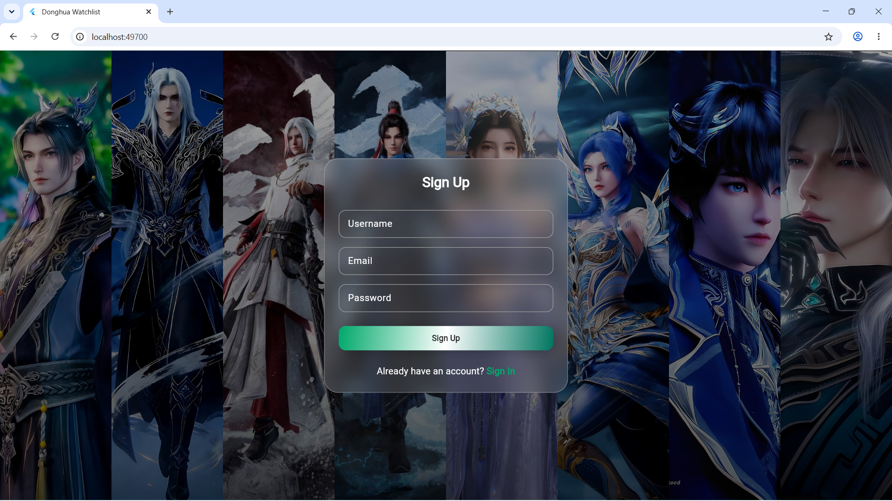
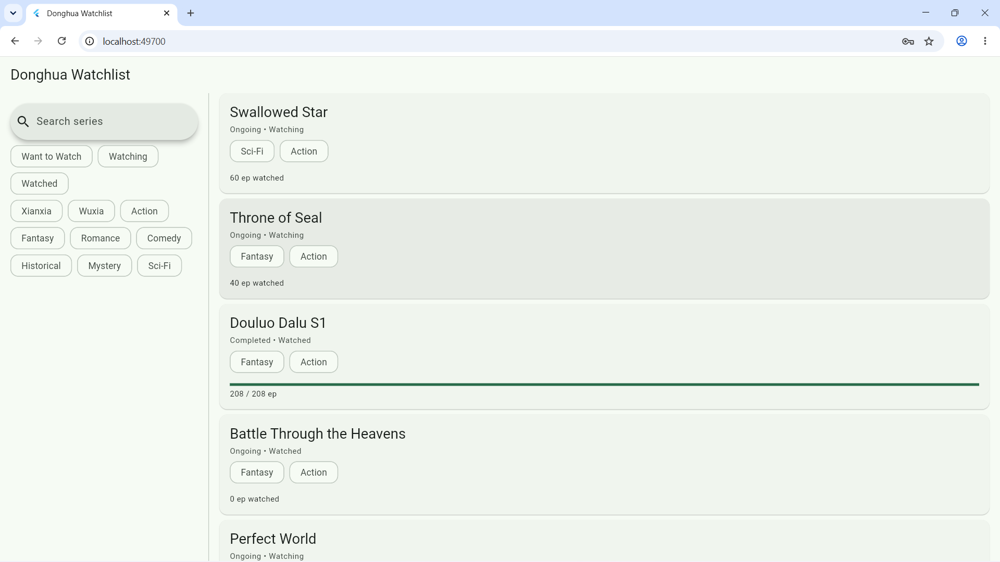
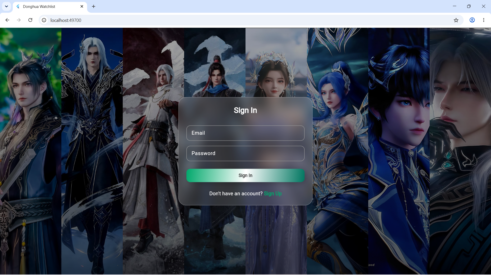

Study Case: Track A = WatchList Donghua 
jadi aplikasi saya adalah aplikasi yang menampilkan list2 donghua yang sudah pernah/belum pernah dinonton. Aplikasinya memiliki track progression sehingga ditau donghuanya sudha dinonton sampai eps brp. Juga ada fitur dimana OnGoing/Completed dimana status tersebut merupakan status series donghua yang sedang berlanjut atau msudah selesai.
Features Implemented:
- WatchList
- Authentication Page (Sign In and Sign Up)

