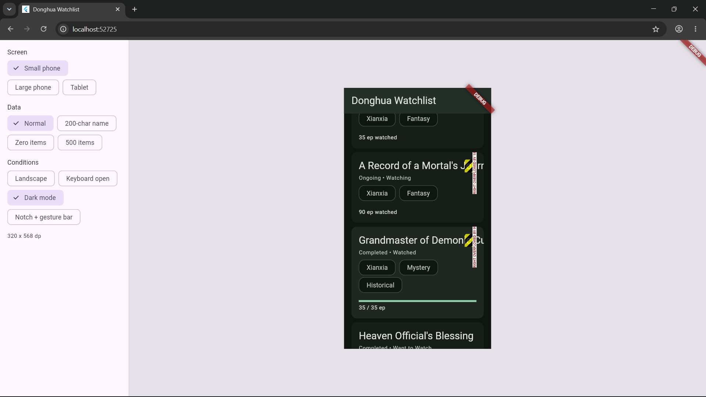
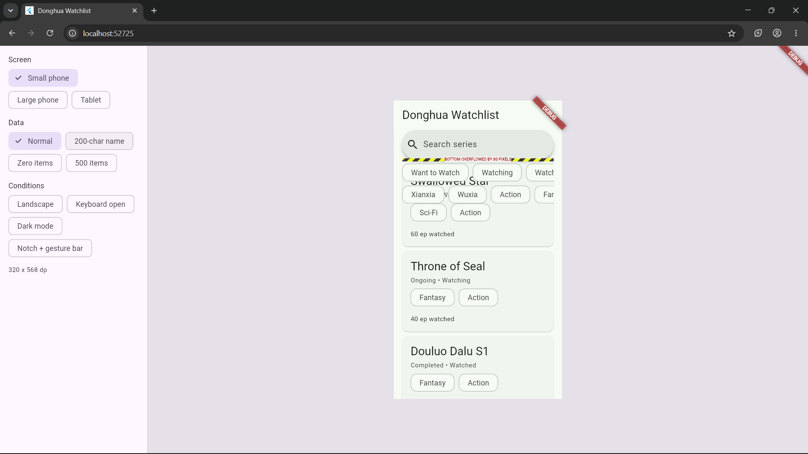
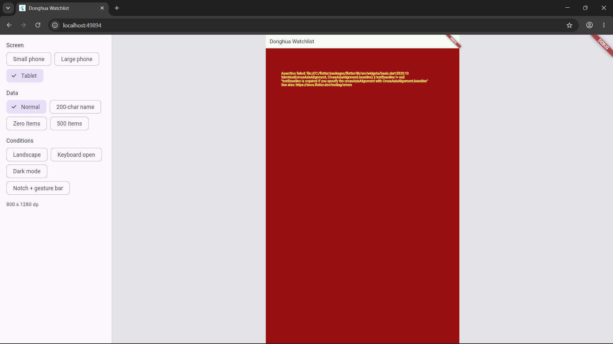

| Screenshot | Constraint Violated | Fix |
|---|---|---|
||Row memberi anak non-flex lebar tak terbatas, jadi teks tidak tahu harus membungkus|Expanded(child: Text(...))|
||Column tidak bisa lebih tinggi dari ruang yang diberikan induknya dan tidak menggulir|hapus tinggi tetap|
||“parent sets position”. Row sebagai parent yang menentukan posisi anak di sumbu silang (vertikal), dan CrossAxisAlignment.baseline hanya bermakna untuk anak yang punya garis dasar teks|CrossAxisAlignment.stretch|